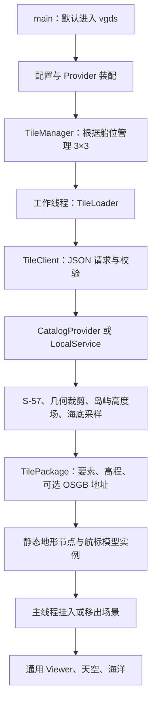

# Veylaxis 项目阅读指南

建议从这份文档开始，再打开 [src/main.cpp](../src/main.cpp)。第一遍沿调用链阅读，不必先看完 GDAL、OSG 或所有三角剖分代码。源码中的 `【阅读导航】` 是本次新增的中文入口提示；函数前的注释解释关键约束。

这份指南按当前代码组织编写。早期阶段报告记录当时状态，例如“12 米平顶”“默认打开区域 001”，不能直接当作当前默认行为。

源码已完成阅读排版：密集语句和函数体展开，缩进统一，保留中文注释；规则及验证方式见 [代码排版说明](code-formatting.md)。

## 1. 先认识两条可运行链路

当前主场景：**随着船位变化请求 3×3 区块，直接把返回的数据或缓存变成场景节点**。它不要求预先为每个区块生成 GeoTIFF。



保留的离线实验链路：`reconstruct` 将指定区域的 S-57 海底数据写成带地理参考的 `.tif`；`view` 再查看这个文件或导出地形模型。它适合检查算法、区域 001 和九块拼接实验，不是当前动态场景的必经步骤。

## 2. 目录与构建目标地图

|位置|责任|第一遍如何读|
|---|---|---|
|`src/main.cpp`|命令分发|先读|
|`include/veylaxis/vgds`|数据、请求、网格和 Provider 公共接口|先看 Types / Grid / ITileProvider|
|`src/vgds`|海图读取、选源、裁剪、缓存、算法和服务实现|按后面的调用顺序读|
|`include/veylaxis/streaming`、`src/streaming`|主程序的异步区块管理与模型适配|当前动态场景的主线|
|`src/bathymetry.cpp`、`src/reconstruction.cpp`|离线管线和可替换海底算法|动态链路读通后再深入|
|`src/viewer.cpp`、`src/CameraNavigation.h`|共享显示外壳、相机和截图|最后进入渲染细节|
|`src/environment`|SilverLining 天空、Triton 海洋适配|暂时视作环境子系统|
|`config`|启动位置、网格、数据源、算法及模型路径|先与主程序对照阅读|
|`scripts`|构建、运行、测试及诊断入口|不承担核心算法|
|`tests`|回归测试和算法示例|每读完一层看对应测试|
|`S57_DATA`|输入海图及更新文件|作为数据，不按源码阅读|
|`output`|生成结果、索引、缓存、诊断报告|可核对输出，不是实现源码|
|`plugins`|项目使用的 DMU 二进制插件|查看部署关系即可|
|`third_party/earcut`|多边形三角剖分依赖|第一遍跳过|
|`build`|CMake 工程和编译输出|第一遍跳过生成代码|

打开根目录 [Veylaxis.slnx](../Veylaxis.slnx)。几个构建目标的含义：

|目标/配置|含义|
|---|---|
|Veylaxis|主程序，含动态场景及离线命令|
|Test|统一测试入口；不同命令参数进入不同测试|
|VgdsData|共享的数据服务静态库，含 GDAL 适配及数据算法|
|VgdsOsgBuilder|可选静态渲染缓存构建库，允许依赖 OSG|
|VgdsService|独立本地 JSONL 服务程序，读取标准输入、输出响应|
|VEYLAXIS_VGDS_ONLY|只编译纯数据核心及测试，无 OSG/GDAL/Qt；不是完整 VGDS 服务|

VGDS 是有接口边界的数据服务子系统。主程序目前通过**进程内 JSON 端点**调用它；独立 VgdsService 可以走标准输入输出。当前 Viewer 没有启动另一个服务进程，也没有使用 HTTP。拆分静态库用于控制依赖和复用代码，不代表每个库都需要独立运行。

## 3. 第一遍：入口、配置与场景装配

依次打开：

1. [src/main.cpp](../src/main.cpp)：读 `main()`。无参数且开启 OSG Builder 时进入 `vgds`；显式 `reconstruct`、`view` 进入离线工具。关闭该构建开关时默认退回旧栅格 Viewer。
2. [config/vgds-catalog.json](../config/vgds-catalog.json)：认清 grid、source、start、layers、cache、island_terrain。这里决定去哪里、取什么数据，不是天空海洋内部配置。
3. [src/streaming/Viewer.cpp](../src/streaming/Viewer.cpp)：先读 `runVgdsViewer()`，暂时跳过事件类。顺着 `readServiceConfiguration → makeProvider → TileClient → ModelRegistry → TileManager → showTerrain` 读下去。
4. [src/vgds/Configuration.cpp](../src/vgds/Configuration.cpp)：读 `readServiceConfiguration()` 和 `makeProvider()`。mock、s57、catalog 是三种数据源选择；来源载入回调向岛屿高度场提供完整轮廓。

读完应能回答：F5 从哪启动？请求哪些图层？谁选择海图？谁生成场景节点？

## 4. 第二遍：理解数据契约和坐标

依次读 [Types.hpp](../include/veylaxis/vgds/Types.hpp)、[ITileProvider.hpp](../include/veylaxis/vgds/ITileProvider.hpp)、[Grid.cpp](../src/vgds/Grid.cpp)、[Service.hpp](../include/veylaxis/vgds/Service.hpp)。

重点对象：

|类型|理解要点|
|---|---|
|GridSpec|CRS、网格原点、边长可配置，当前默认 UTM 19N / EPSG:32619、1000 米|
|TileID / TileRequest|请求哪一个网格、哪一块、哪些图层；requestId 用于校验响应|
|Feature|原物标身份、片段身份、数据版本、几何及原始属性|
|BoundaryKind|真实地理边、人工裁剪边、未知边必须区分|
|TerrainData|规则采样的高程、有效掩码及可选法线|
|RenderArtifact|可重新生成的渲染文件地址、原点及完整性元数据|
|TilePackage|上述数据的一次响应；不包含 OSG 节点|
|Dataset / TerrainSource|完整源数据集 / 可按全局位置求高程的函数|

阅读 C++ 写法时可记住：`Result<T>` 是 `variant<T,TileError>`，通常先用 `get_if<TileError>` 检查错误；`optional` 的空值表示缺少结果，不等于数值零；类中的 `Impl` 是把实现细节藏到 cpp 的方式；Loader、TerrainSource 等回调把算法或通信实现传入调用方；`osg::ref_ptr` 表示共享资源持有，`osg::observer_ptr` 只观察对象是否还活着，不阻止释放。

三个坐标层次尤其重要：

1. S-57 原始经纬度经 GDAL 投影，成为全局米制 XY。
2. 每个 Tile 的网格、物标先减去自身 `tileOrigin`，成为 Tile 内局部坐标。
3. TileManager 加上区块相对网格原点的位置，Viewer 再把场景移到启动区附近，避免数百万米大坐标影响渲染精度。

合起来，最终场景坐标仍等于“全局位置减场景原点”。船只直接使用这个最终位置，并没有再套用 Tile 平移。

Tile 编号采用 `floor((位置−原点)/边长)`，所以负编号正常。点归属为左闭右开，落在公共边上的点只属于一个 Tile。默认船位 (498700,4860750) 对应 Tile (-5,4)。

算法中的**水深向下为正**；场景的 **Z 向上为正**，所以海底高程一般为负。`valid=0` 是无数据，不能当作海面零高程。陆地起伏是模拟高度，不能当作 ENC 提供的实测陆地高程。

读完看 [CoreTests.cpp](../tests/vgds/CoreTests.cpp)：用最小测试理解网格、字段和协议约束。

## 5. 第三遍：船移动后，谁负责请求与卸载

依次读：

1. [Motion.hpp](../include/veylaxis/streaming/Motion.hpp)：`advance()` 只改变米制船位，手动方向或自动往返都由它计算。
2. [streaming/Viewer.cpp](../src/streaming/Viewer.cpp)：读 `MotionEvents` 与 `StreamingUpdate::operator()`；每帧推进位置、更新船模型、调用 `tick()`。
3. [TileManager.hpp](../include/veylaxis/streaming/TileManager.hpp)：先认清状态、Loader 回调和统计。
4. [TileManager.cpp](../src/streaming/TileManager.cpp)：按构造函数、`Impl::run()`、`tick()`、`clear()`、析构函数的顺序阅读。
5. [TileLoader.cpp](../src/streaming/TileLoader.cpp)：读 `makeLoader()` 返回的工作任务。

这里有两个执行角色：主场景线程负责挂接/卸载节点；一个工作线程负责请求数据、读取模型、生成尚未挂接的节点。完成队列是交接处。移动一格通常替换三块，重复 tick 不应重复请求；过期任务即使完成，也不能挂进新视野。

TileLoader 先处理静态岛屿/海底：存在 OSGB 时校验并读取；没有文件输出时从数据在内存生成。然后附加航标实例，整体交给 TileManager 管理。因此卸载 Tile 会卸载其中的航标；共享模型原型可以继续留在有界缓存中。

读完看 [StreamingTests.cpp](../tests/vgds/StreamingTests.cpp)，重点看过期结果、异常重试、重复请求及 observer_ptr 检查节点释放的案例。

## 6. 第四遍：跟随一个请求进入 VGDS

建议顺序：

1. [TileClient.cpp](../src/vgds/TileClient.cpp)：请求编码、调用端点、响应解码，以及请求号/Tile/图层校验。
2. [JsonCodec.cpp](../src/vgds/JsonCodec.cpp)：先找 `encodeRequestJson`、`decodeJson`、`validate`，不必第一遍细读每个 JSON 字段。
3. [LocalService.cpp](../src/vgds/LocalService.cpp)：先理解单数据集 `request()` 如何按图层裁剪、生成和缓存。
4. [Catalog.cpp](../src/vgds/Catalog.cpp)：再读多源版本，顺序为 `EncCatalog` 构造、`query / owner / ownedRegion`、`CatalogProvider::request()`。
5. [S57.cpp](../src/vgds/S57.cpp)：读 `readS57()`，看更新文件、数据版本、坐标转换、对象类别以及来源属性。
6. [Geometry.cpp](../src/vgds/Geometry.cpp)：读 `intersectFeature()`、`clipFeature()`，再看边界分类辅助函数。
7. [TileCache.cpp](../src/vgds/TileCache.cpp)：读 `fetch()` 和 `prune()`，理解提交标记、哈希校验和容量限制。

Catalog 使用真实覆盖与比例尺优先级分配数据，不能把所有重叠海图的对象直接叠加。sourceObjectId 跟随源物标，fragmentId 跟随裁剪结果；公共边不允许靠“对象重复了就随便丢一份”来替代明确归属规则。

缓存命中意味着可以跳过部分解析/生成，并不意味着文件永远可信。数据版本、算法版本和构建器版本都参与相关缓存身份；修改逻辑时应检查是否需要更新版本，防止读到旧结果。

对应测试：[ServiceTests.cpp](../tests/vgds/ServiceTests.cpp)、[S57Tests.cpp](../tests/vgds/S57Tests.cpp)、[CatalogTests.cpp](../tests/vgds/CatalogTests.cpp)。

## 7. 第五遍：分开阅读陆地、海底、航标三条支线

### 陆地：完整岛屿高度场 → Tile 网格

先读 [IslandTerrain.hpp](../include/veylaxis/vgds/IslandTerrain.hpp)，再读 [IslandTerrain.cpp](../src/vgds/IslandTerrain.cpp) 的 `addDataset()`、`sample()`，最后看 [OsgBuilder.cpp](../src/vgds/OsgBuilder.cpp) 的 `proceduralSurface()`、`walls()` 和 `createLandNode()`。

完整岛轮廓用于确定真实海岸距离，高度函数由距离得到起伏；裁剪后的 Tile 只负责采样/出网格。相邻 Tile 在同一全局点使用同一高度函数和法线依据。`ArtificialClip` 不参与建海岸侧壁。Earcut 负责多边形三角剖分，不负责从海图推算高程。

旧的 `height=12` 平顶分支仍存在；当前默认配置 `island_terrain.enabled=true`，走程序化高度场，`height_m=42` 是该配置的高度上限参数。不要只看到那一个常量就认定所有陆地都是 12 米。

对应测试：[IslandTerrainTests.cpp](../tests/vgds/IslandTerrainTests.cpp)。

### 海底：DEPARE / DEPCNT / SOUNDG → 高程采样

先读 [reconstruction.hpp](../include/veylaxis/reconstruction.hpp) 的 `ISeabedReconstructor`、[reconstruction.cpp](../src/reconstruction.cpp) 的 `base()`、`evaluate()`，再读 [BathymetryReader.cpp](../src/vgds/BathymetryReader.cpp) 和 [Bathymetry.cpp](../src/vgds/Bathymetry.cpp)。

输入适配器提取原始深度信息；算法估算水深；数据层限制 DEPARE 覆盖并转换成负高程，再给 Tile 采样。算法接口便于替换，但目前动态海底构建处具体创建的是 LinearContourReconstructor，替换算法时还需调整该装配位置，不是只加一个类便会自动启用。

离线管线在 [src/bathymetry.cpp](../src/bathymetry.cpp) 的 `runReconstruction()`，它复用海底算法，同时承担区域选择、栅格写出和诊断等工作。两个 bathymetry 文件不是同一个入口：小写目录顶层文件是离线命令，`src/vgds/Bathymetry.cpp` 是动态数据服务适配。

对应测试：[reconstruction_tests.cpp](../tests/reconstruction_tests.cpp)、[SeabedMaritimeTests.cpp](../tests/vgds/SeabedMaritimeTests.cpp)。

### 航标：原始对象属性 → 配置规则 → 共享模型实例

先打开 [navigation_models.json](../config/navigation_models.json)，再读 [ModelRegistry.hpp](../include/veylaxis/streaming/ModelRegistry.hpp) 和 [ModelRegistry.cpp](../src/streaming/ModelRegistry.cpp)。推荐函数顺序是 `reload → match → load / dmuPlugin → instantiate`。

VGDS 只提供位置、类别和属性，不知道具体模型文件。Registry 按 objectClass 和可选属性匹配，规范化路径后复用模型资源，为每个物标创建独立变换。缺失分类不补默认值，缺失模型告警并跳过。DMU 插件及密码 Options 位于渲染层。运动船只通过同一 Registry 加载，但挂在独立运动节点，不随地形 Tile 卸载。

模型路径相对于模型 JSON 所在目录；VGDS 配置中的数据源/缓存路径当前按项目工作目录解析。阅读时不要把这两种相对路径规则混在一起。

对应测试：[NavigationModelTests.cpp](../tests/vgds/NavigationModelTests.cpp)；进一步看 [DMU 加载说明](vgds/dmu-model-loading.md) 和 [航标可见性核查](vgds/navigation-visibility-audit.md)。默认启动九块内没有航标数据，不能用那里是否出现浮标作为模型加载的唯一验收。

可以拿上一轮实际核查的一枚物标串起整条链路：默认网格 Tile `(9,-3)` 内的 `US2EC04M:BOYLAT:022606D1B56E1170`，原始分类 `CATLAM=2`，投影位置约 `(513468.145,4854130.765)`。S57 适配器提取身份和属性；Catalog 返回该 Tile 中的点；JSON 保留这些字段；Registry 命中 starboard 规则并加载 `030013.dmu3D`；实例减去 Tile 原点，再由外层平移到场景。相同位置还可能返回 LIGHTS 要素，但它没有默认模型，不会自动再造一个浮标。

## 8. 第六遍：最后读 OSG 和环境

读 [src/viewer.cpp](../src/viewer.cpp) 的 `showTerrain()`，再看 [CameraNavigation.h](../src/CameraNavigation.h) 的 `ZUpManipulator`。

`showTerrain()` 接收已经构建的场景节点，不负责海图解析。它创建 Viewer、相机和交互，按配置加入环境。海洋截图使用固定局部坐标相机，截图不保证对准船只或航标；F1/F2 海面/水下视角也应结合局部坐标理解。

然后读 [MarineEnvironment.cpp](../src/environment/MarineEnvironment.cpp)，把它看成环境装配入口：天空向海洋提供光照，海洋位于 Z=0，SDK 配置和资源从程序运行目录取得。最后再深入 SilverLiningSkyBox、TritonOceanSurface 各自的渲染回调与资源管理。第一遍不用读 SDK 内部源码。

依赖分工：GDAL/GEOS 负责海图读取、投影与几何运算；OSG 负责场景、模型和 Viewer；Earcut 负责多边形三角剖分；nlohmann_json 负责配置及数据协议；Qt 当前用于环境适配的配置/路径等功能，主 Viewer 不是 Qt 窗口应用；SilverLining/Triton 提供天空海洋；DMU 插件负责专有模型格式读取。

## 9. 建议的断点与实践顺序

第一次调试选一个固定位置，只跟一块数据，不必一次追九条请求：

1. 在 `runVgdsViewer()` 读完 setup 后暂停，观察 grid、start、layers、catalog。
2. 在 `TileManager::tick()` 的 locate 后观察中心 Tile 与 desired 九块。
3. 在 `Impl::run()` 调用 loader 前观察 requestId 和 Tile。
4. 在 `CatalogProvider::request()` 观察 selected 海图、缓存键及是否走生成回调。若直接命中缓存，没有进入 S57 解析是正常情况。
5. 在 `readS57()` 或 `intersectFeature()` 观察完整要素和裁剪片段的 ID、属性及边类型。
6. 在 TileLoader 得到 package 后观察 features、terrain、artifacts，确认“有数据”发生在哪一层。
7. 在 `ModelRegistry::instantiate()` 或 `createLandNode()` 观察节点创建；最后在 tick 消费完成结果时观察节点挂入。
8. 移动跨过一格，观察 requests / unloaded / discarded，而不是只盯总内存。共享模型缓存、GPU 资源及活动实例不是同一份统计。

若想先看较短代码，按 **CoreTests → ServiceTests → StreamingTests → 真海图测试** 阅读。测试通过小输入说明边界约束，通常比从一个完整帧里单步跟完更容易理解。

## 10. 运行、测试与进一步阅读

在项目根目录执行：

```powershell
.\scripts\build.ps1
.\scripts\view-vgds.ps1
.\scripts\view-vgds.ps1 -Tour
.\scripts\view-vgds.ps1 -LandOnly

# 不引入 GIS/渲染依赖的纯核心检查
.\scripts\test-vgds.ps1
# 不带 OSG 的完整数据服务检查（仍使用 GDAL）
.\scripts\test-vgds-service.ps1 -NoOsgb
# 正常工程的全部已有测试
& 'C:/Program Files/CMake/bin/ctest.exe' --test-dir build -C Release --output-on-failure
```

`-LandOnly` 关闭天空海洋环境，不是仅返回 land 图层；图层仍由 VGDS 配置决定。`--tour` 是自动往返运动演示。

`VEYLAXIS_VGDS_OSGB=OFF` 是构建开关，当前也会移除使用该适配器的动态 Viewer；配置中的 `osgb:false` 则是运行时不输出静态文件，动态 Viewer 仍可在内存建模。先区分这两者再做配置实验。

后续资料按问题查阅：

- [S1 核心数据层](vgds/s1-core.md)
- [S2 本地服务与裁剪](vgds/s2-service.md)
- [S3 动态区块](vgds/s3-streaming.md)
- [S4 S-57 接入](vgds/s4-s57.md)
- [海底技术设计](technical-design.md)
- [天空海洋融合](marine-integration.md)

中文注释批次仅增加注释和阅读文档，没有改变接口、算法、配置或运行行为。44 个源码/头文件增加 84 行中文注释；该批次去除整行注释和空行后，修改前后源码逐行一致。随后进行的排版批次只调整空白与换行，改用有效 C++ token 一致性检查；见上方代码排版说明。注释批次清单与校验摘要保留在 `output/vgds/reading-comments-validation.json`。

验证结果（2026-10-29）：Release 下 Veylaxis、VgdsService、Test 重新构建成功；6 项相关回归测试全部通过（Core、本地服务、S-57、动态区块、模型映射、真实 DMU），耗时 9.85 秒；指南中的 53 个文件链接全部存在。日志为 `build/reading-comments-regression.log`，链接与源码一致性摘要为 `output/vgds/reading-guide-validation.json`。本次未重复运行耗时的完整地形路线验收。
