# Veylaxis 海底重建技术文档

## 1. 本阶段目标与坐标约定

从 S-57 ENC 提取 `DEPCNT`、`SOUNDG` 和 `DEPARE`，生成带地理参考的连续海底高程网格，并让 OSG 能直接构建地形网格。算法与数据读取、坐标转换、栅格写入和显示解耦。

区域边界按 `(west, south, east, north)` 接收。用户提供的第二个角点纬度更高，因此解释为东北角。实验 001 的原始矩形在 WGS84 中定义，输出投影为 WGS84 / UTM zone 19N（EPSG:32619），所有距离、像元尺寸及 OSG 坐标均使用米。

深度 `depth` 向下为正，输出高程 `elevation = -depth`。水平 CRS 不代表垂直基准：高程仍相对于原 ENC 的 sounding datum，未做椭球高、正高或潮位转换。输出保留 `ENC_DSPM_SDAT` 与 `ENC_DSPM_VDAT`，两者不可互换。

## 2. 工程结构

| 路径 | 作用 |
| --- | --- |
| `include/veylaxis/reconstruction.hpp` | 无 GDAL/OSG 依赖的重建接口、基础数据结构及局部冲突修复接口 |
| `src/reconstruction.cpp` | 等深线距离插值、测深残差修正、冲突过渡处理 |
| `src/main.cpp` | 统一入口，选择 reconstruct 或 view 功能 |
| `src/bathymetry.cpp` | 参数、S-57 读取、投影、提取、DEPARE/ROI 掩膜、GeoTIFF 和报告 |
| `src/viewer.cpp` | GDAL 读取高程，OSG 网格构建、窗口预览、OSGT 导出 |
| `tests/` | 算法测试和实际区域逐像元校验 |
| `scripts/` | 构建、运行、测试、预览、运行时环境配置 |
| `output/region001/` | 最终栅格、原始栅格、质量、矢量提取、报告和 OSG 场景 |

```mermaid
flowchart LR
    ENC[ENC .000 + .001] --> GDAL[GDAL / OGR]
    GDAL --> CRS[WGS84 到 UTM19N]
    CRS --> Sources[等深线 / 测深点 / 水深区]
    Sources --> Interface[ISeabedReconstructor]
    Interface --> Raw[DEPARE 约束的原始高程]
    Raw --> Repair[局部拓扑冲突过渡]
    Repair --> TIFF[GeoTIFF + 质量 + 报告]
    TIFF --> OSG[OSG 地形网格]
```



## 3. 数据处理流程

1. `GDALOpenEx` 仅以 S57 驱动只读打开 `.000`；使用 `UPDATES=APPLY`，让 GDAL 在内存应用同目录的 `.001` 等更新，保留原始文件。
2. 使用 `SPLIT_MULTIPOINT=ON` 将 `SOUNDG` 拆为独立 Point Z。深度取几何 Z；等深线取 `VALDCO`；水深区取 `DRVAL1/DRVAL2`。不对字符串或未定义字段默认为 0。
3. 检查 WGS84、米制水深、GEOS 与投影数据。当前 CLI 只支持北半球 UTM 19N 范围。
4. 将经纬度矩形边缘加密为每边 64 段，再投影。建立 UTM 外包网格，最终以精确 ROI 的像元中心掩膜裁切，而非把投影外包矩形全部当作有效区域。
5. 默认在投影外包范围外读取 20 km 支撑范围，并对几何做实际裁切。边界外支撑用于插值，不扩大最终输出范围。
6. 根据 DEPARE 几何确定每个像元所属区间。孔洞、区域外、无水深区和无支撑位置保留 NoData，不补零。暂不读取 `LNDARE` 或合成陆地。
7. 对每个 DEPARE，只采用落在其边界上的等深线段。以线段中点到区域边界小于 0.05 m 为关联容差，避免其他海盆相同深度的线参与当前区域。
8. 输出严格约束的原始高程，再对检测到的相互矛盾边界做显式局部过渡，输出最终高程与质量。

需要注意：S-57 原始要素的外包矩形命中不意味着几何真正进入区域，所以流程还会做投影后的 `Intersection`。测深点只有落在 DEPARE 内且水深符合区间时才参与拟合，其他点计入拒绝统计。

## 4. 相邻等深线线性坡面

设当前 DEPARE 水深区间为 `[D0, D1]`，查询点到两条相邻上下限等深线的最短线段距离为 `d0, d1`：

```text
t = d0 / (d0 + d1)
Dbase = D0 + (D1 - D0) * t
```

两条直线平行时，这是严格的线性坡面；对弯曲等深线则是沿归一化距离坐标的线性水深过渡，不是全局单平面，也不是约束 Delaunay 三角网。它在正常边界上保持等深线值，易于替换，适合作为首版基线。最近线段切换处允许斜率折点，不宣称 C1 光滑。

如果只有一侧等深线，基面取已知线的水深，不虚构另一侧海底形态；质量为 2。若两侧均无可用等深线，则返回空值。浅水区没有 0 m 等深线时，不将 DEPARE 外边界自动当作实测 0 m 等深线。

## 5. SOUNDG 局部修正

对每个有效测深点计算相对于基面的深度残差，只在同一个 DEPARE 多边形内进行局部插值。默认影响半径 `R=250 m`，核为紧支撑 Wendland 形式：

```text
r = distance / R
w = (1-r)^4 * (4r+1) / r^2,  0 < r < 1
```

归一化残差使用 `sum(w*residual) / (1+sum(w))`，因此在支撑边缘回到基面。为保护等深线，双侧有线时使用 `4t(1-t)` 衰减；单侧有线时使用到已知线距离的 smoothstep 衰减。源点残差先除以其自身衰减系数，使源点位置可恢复观测深度。最终在正常区域钳制到 DEPARE 区间。

在精确测深坐标处恢复观测值，与相邻像元中心恰好等于观测值是两回事。`region001_sounding_check.csv` 记录的是算法在观测位置的求值，不能作为独立精度验证；这是插值复现检查。

## 6. 矛盾水深区边界的处理

本海图在 ROI 西北角有约 73.178 m 公共边界，两侧区间为 `[5.4,18.2]` 和 `[36.5,91.4]`。两侧范围不相交，无法同时满足严格区间限制和连续性。源数据的 18.2 m 等深线与这条边界重合，36.5 m 等深线在其端点接入。

处理分两层：

- `region001_elevation_raw.tif` 保留严格 DEPARE 区间约束的结果，保留该数据冲突造成的台阶。
- `region001_elevation.tif` 在冲突线 100 m 内建立局部过渡。采用半径 100 m 的 Wendland 加权平均；离冲突线 15 m 内完全采用平滑结果，15–100 m 通过 smoothstep 混合回原高程。卷积只使用原始有效像元，不把 NoData 当 0，也不改变 ROI 掩膜。

过渡区标为质量 3，局部放宽原 DEPARE 数值区间；区域范围约束继续保持。原始等深线值在过渡区内也可能被调整。其目的在于处理这一处已检测的数据矛盾，不是根据插值计算结果推断真实陡坎不存在。若后续要求每个像元绝对满足原 DEPARE 上下限，应使用原始栅格，并接受这里无法连续的事实。

质量值不是测量误差或置信概率：

| 值 | 含义 |
| --- | --- |
| 0 | 区域外 / 缺少有效支撑，NoData |
| 1 | 同一区域上下限等深线均存在 |
| 2 | 缺少一侧等深线，采用单侧基面和有效测深修正 |
| 3 | 源 DEPARE 冲突边界局部过渡，覆盖原 1/2 分类 |

## 7. 替换重建算法

实现 `ISeabedReconstructor::evaluate(XY position, int area)`，返回正向下的米制深度及质量，不能求值时返回 `std::nullopt`。算法只消费 `ReconstructionInput`，不直接持有 GDALDataset 或 OSG 节点。

新增算法后，在 `src/bathymetry.cpp` 的接口实例化处选择新实现，并扩展 `--algorithm` 解析。当前只注册 `linear`；未知名称直接报错，不会静默使用默认算法。ROI、投影、数据提取、输出和 OSG 代码不必修改。若新算法可直接处理不一致边界，可替换或关闭后续冲突过渡步骤。

后续可实现约束 TIN、RBF、最小曲率或泊松重建。数据支持密度、垂直基准与质量信息需要随算法保留，不能仅更换插值器而丢失这些语义。

## 8. GeoTIFF 与 OSG

高程输出为单波段 Float32、米单位、NoData=-9999、DEFLATE 压缩、瓦片 GeoTIFF；带 EPSG:32619、仿射变换、数据来源及垂直基准说明。质量为同尺寸、同地理变换的 Byte GeoTIFF，NoData=0。像元中心以 `(col+0.5,row+0.5)` 计算。

OSG 读取 GeoTIFF，不依赖 OSG GDAL 插件。用栅格中心作为 XY 局部原点，避免直接把数百万量级 UTM 坐标存入 float 顶点产生精度损失；Z 保持相对于 ENC 水深基准。节点 user values 保存原点、水平 CRS WKT 和 Z 缩放。包含 NoData 顶点的三角形不生成。

正式 Viewer 已融合 SilverLining 天空和 Triton 海洋，XYZ 使用米，Z 缩放统一为 1。`--marine off --z-scale 10` 仅用于独立海底夸张检查，融合模式拒绝不同倍率。GeoTIFF 和默认导出的海底模型始终保持原始米制高程。环境的部署、按键及实测结果见 [海洋场景融合说明](marine-integration.md)。

`--export file.osgt` 或 `--export file.osgb` 生成场景后立即退出，不创建窗口；不带它则启动 Trackball 交互窗口。文本导出使用 `precision 17` 保留 UTM 原点精度，二进制模型 `region001_terrain.osgb` 也已生成。测试重新读取模型，并逐顶点验证 XYZ 坐标与原始栅格一致、Z 倍率为 1、三角形不包含 NoData。

鼠标左键拖动旋转、中键平移、滚轮缩放、空格恢复初始斜视角、W 切换线框。

## 9. 构建和运行

本机已经存在 GDAL 3.12.4、OSG 3.6.5、GEOS、PROJ 和 SQLite，实际使用 `C:\CProj\vcpkg\installed\x64-windows`。编译器为 MSVC 19.52 / Visual Studio 2026，CMake 使用 `C:\Program Files\CMake\bin`，没有采用 PATH 中较早的 Strawberry CMake。没有安装额外库，也没有改写系统环境变量。

```powershell
cd C:\CProj\Veylaxis
.\scripts\build.ps1 -VcpkgRoot C:\CProj\vcpkg
.\scripts\run-region001.ps1
.\scripts\test.ps1
.\scripts\view-region001.ps1 -ExportOnly
.\scripts\view-region001.ps1
```

新机器可先在 vcpkg 中安装最小功能集合（当前机器不需要重装）：

```powershell
& C:\CProj\vcpkg\vcpkg.exe install 'gdal[core,geos,sqlite3]:x64-windows' 'osg[core,plugins]:x64-windows'
```

构建脚本默认生成器是 `Visual Studio 18 2026`。其他机器也可直接用 CMake 并选择其已安装生成器：

```powershell
cmake -S . -B build -A x64 -DCMAKE_TOOLCHAIN_FILE=C:/CProj/vcpkg/scripts/buildsystems/vcpkg.cmake -DVCPKG_TARGET_TRIPLET=x64-windows
cmake --build build --config Release --parallel
```

运行脚本优先使用 CMake 缓存中的 vcpkg 路径，然后使用 `VCPKG_ROOT`，最后尝试本机默认目录。GDAL 和 OSG DLL 必须来自同一 vcpkg 配套，不能混用前面诊断命令时使用的 QGIS DLL。当前工程是本地开发部署，并未打包成脱离 vcpkg 的独立安装包；迁移时还需部署匹配 DLL、GDAL 数据、`proj.db` 及 OSG 序列化插件。

直接调用 CLI 时先加载运行环境：

```powershell
. .\scripts\runtime.ps1
& .\build\Release\Veylaxis.exe reconstruct --input S57_DATA/ENC_ROOT/US2EC04M/US2EC04M.000 --output output/region001 --resolution 5 --buffer 20000 --sounding-radius 250 --algorithm linear
```

可以用 `--bounds west south east north` 更换区域，但当前实现限于 UTM 19N。默认输出会覆盖目标目录中同名成果；源 ENC 只读。命令退出码为 0：完整区域成功；1：输入、运行或写入错误；2：已生成结果，但 ROI 内存在无支撑像元。

## 10. 验证与后续工作

CTest 包含五项：合成等深线/测深/局部修复测试、真实区域生成、重新打开成果逐像元验证、OSG 无窗口场景导出、导出模型逐顶点 XYZ 1:1 校验。真实数据校验包括 CRS、分辨率、ROI 外 NoData、ROI 内无空洞、原始高程的 DEPARE 区间、最终结果在过渡区外的区间、质量 3 的局部范围以及相邻像元高程跳变量回归阈值。该阈值只用于当前 5 m 实验区域，不代表普遍坡度限制或物理精度。`scripts/test-marine.ps1` 另行执行需要实际 OpenGL 窗口的天空/海洋融合测试。

后续优先项是更大比例尺或更密集测深数据、要素级垂直基准处理、冲突边界的人工/数据源复核、约束 TIN、空间索引，以及真正独立的测深检验。当前线段搜索和局部卷积用于小区域原型；CLI 限制最多 400 万像元，避免误输入产生过大内存和运行开销。

参考： [GDAL S-57 驱动与更新选项](https://gdal.org/en/stable/drivers/vector/s57.html)、[OGR C++ 数据读取](https://gdal.org/en/stable/tutorials/vector_api_tut.html)、[GDAL 栅格及地理变换](https://gdal.org/en/stable/tutorials/raster_api_tut.html)。
