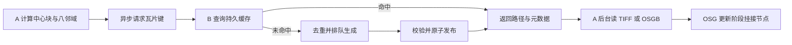

# 分块、缓存与 A/B 加载链路（方案讨论，尚未实现）

## 结论

当前主块周围的八块可以按逻辑瓦片请求：连同中心块，共 3×3 个瓦片。采用 1 km×1 km 的投影米制瓦片、5 m 高程采样，适合作为第一阶段实验配置。瓦片尺寸、采样分辨率与显示 LOD 是三个独立参数，不宜把提高网格密度当作增加原海图精度。

程序 A 负责交互、场景和渲染；程序 B 负责源数据管理、重建和持久缓存。缓存命中返回已完成成果的位置和元数据；未命中进入异步生成队列。A 不在渲染线程上等待 B。

这里有两种不同工作：S57 到高程需要海底重建算法；高程到三角网只是生成顶点、索引、法线等显示数据。A 加载已生成高程时无需重新运行海底插值算法。物理文件既可每逻辑块一张 GeoTIFF，也可从更大的高程文件中读取对应窗口；八张独立文件不是技术前提。

## 当前实测

2026-10-26 在本机 Release 程序上，对当前区域 001 连续执行各三次。输入为约 0.974 km²、5 m 网格、196×200 个高程像元；当前模型含 39,200 个顶点，77,212 个有效三角形。

| 操作 | 第 1 次 | 第 2 次 | 第 3 次 | 中位数 |
| --- | ---: | ---: | ---: | ---: |
| 新进程读取 ENC、重建、输出全部成果 | 3523.89 ms | 3310.74 ms | 2696.75 ms | 3310.74 ms |
| 新进程读取高程、建网格、写 OSGB | 410.59 ms | 385.75 ms | 371.81 ms | 385.75 ms |

第一项包括源数据打开、投影/裁切、DEPARE/等深线关联、插值、冲突修复、GeoTIFF、GeoPackage 和报告写入。第二项包括进程/DLL 启动、读取高程、建网格、计算法线和写模型文件。两者均不是纯算法内核耗时。未做系统冷缓存控制，测量次数有限，不能据此直接承诺九块加载耗时、服务吞吐或 GPU 帧率。持续服务复用已打开数据后的性能也尚未实测。

高程 GeoTIFF 为 102,407 字节，OSGB 为 2,496,524 字节。当前模型的顶点、法线、颜色、索引数组合计约 2.5 MB；GPU 缓冲区可能再保存一份，尚有 OSG 节点、分配器及其他渲染资源开销。

原始计时保存在 `build/tile-benchmark/timings.json`。本次只做基准测量，没有生成邻域八块，也没有实现 A/B 服务。

## 1 km 的规模判断

规则 1 km 瓦片在 5 m 采样间距下为 200×200 个网格单元。采用包含两端边界的共享节点布局时，每块为 201×201=40,401 个顶点和约 80,000 个三角形；九块约 36.4 万顶点、72 万三角形。这个规模值得作为初版起点，最终帧率需要在天空、海洋、阴影等完整场景中测量。

若采样间距改为 1 m，每块约 100 万节点、200 万三角形，九块约 1800 万三角形，数据量约增加 25 倍。局部修复等算法的耗时可能增长得更快。因此先固定 5 m，测试加载和帧耗时，再决定是否需要细网格或分级 LOD。

当前实验 ROI 是经纬度矩形，投影后约 0.974 km²，不能直接作为正式固定 1 km 瓦片网格的定义。正式瓦片应按投影坐标原点和米制边长生成。

## 请求与缓存

对同一网格定义：

```text
tileX = floor((Easting - gridOriginEasting) / tileSize)
tileY = floor((Northing - gridOriginNorthing) / tileSize)
```

请求至少携带数据集/区域标识、tileX、tileY、LOD/分辨率和处理规则版本。只有浮点经纬度或 x/y 不足以唯一确定成果。使用 floor 可以正确覆盖原点以西、以南的负索引。

建议从规范化元数据生成 SHA-256 缓存键：

```text
dataset version / source manifest digest
  + .000 and applied .001/.002/... update chain digest
  + projected CRS and vertical datum convention
  + grid origin, tile size, tileX, tileY
  + sample spacing / LOD
  + algorithm version and parameters
  + support-window and conflict-repair / NoData policy
  + mesh/normal-generation version and color-ramp parameters (for cached models)
```

源文件内容摘要在数据入库或更新时计算并记录；每次请求查询版本号，不必重新扫描全部源文件计算哈希。哈希标识处理成果；还需元数据清单确认文件完整、规则版本匹配，以及缺测/覆盖状态。

响应形态可以是：

```text
READY:   key, elevationPath, qualityPath, optionalModelPath,
         CRS, bounds, tileOrigin, resolution, sourceVersion, coverage
PENDING: key, jobId
FAILED:  key, retryable, reason
PARTIAL: key, paths, coverage, reason
```

同机可通过命名管道或本机 HTTP 传请求与状态，成果放在两进程可访问的缓存目录。跨机器时本地绝对路径不能直接复用，需要对象地址或下载机制。

B 对同一键做任务去重，多个 A 请求共享一个生成任务。写入临时目录，完成并校验后在同一文件系统原子发布；未完成文件不能以 READY 返回。缓存过期通过版本键自然失效，后台按容量清理旧版本，而不是只判断“存在一个同名文件”。

## 进程和线程分工



A 保留三层职责：后台接收/读盘及可选网格构建、更新阶段修改场景树、渲染阶段绘制和上传 GPU 缓冲。每帧限制新增块数量或上传预算，避免八块同时完成时卡顿。已有节点直接复用，不要每帧重复读取文件或重建模型。

B 建议常驻，初始化 GDAL 一次，复用源数据索引和已完成的区域重建结果。并发起步可限制为 1–2 个生成任务，再按实测调整；不要默认同时生成八块。不同工作线程使用独立 GDAL/OGR 数据集实例，尤其不能共享当前会修改空间过滤器和读取游标的 S57 数据集。GDAL 文档也说明普通数据集实例一般不保证线程安全：[GDAL 多线程约束](https://gdal.org/en/stable/user/multithreading.html)。

A 最先请求中心块，随后按相机视野和移动方向加载相邻块。中心向东移动一格时，3×3 范围中通常保留六块，只需加入东侧三块并回收远端块；用内存缓存避免反复创建。持久缓存由 B 管理，A 的 CPU/GPU 驻留缓存另按内存预算回收。

## 优先解决的接缝和位置问题

1. **统一米制网格。** 所有块共用一个投影 CRS、网格原点、像元对齐方式和 Z 基准，不要把经纬度间隔直接当固定 1 km。
2. **共同场景原点。** 当前 Viewer 会把每张 TIFF 的中心减到局部零点；如果直接将九份现有结果加载到同一个根节点，会重叠。A 应用统一场景原点，或按 `tileOrigin - sceneOrigin` 放置每个局部模型。
3. **共同边界节点。** 当前由像元中心建网格，相邻文件最后/第一列之间仍有一个采样间隔，直接拼接会留缝。正式分块应采用共享边界节点，或读取边缘重叠并生成接边三角形；法线也要利用邻块高度计算。
4. **插值与修复的上下文一致。** 当前每块读取 20 km 支撑区，冲突修复半径为 100 m、测深修正半径为 250 m。独立裁块后再修复会让边界结果依赖单块范围。应在外扩计算区完成处理再裁核心，并共享邻域数据和规则；仅共享采样位置不能保证所有算法的边界值一致。

邻域实验应分别重建九个 1 km×1 km 块并拼接，直接检验独立计算造成的边界差异。整片 3 km×3 km 重建只作为对照，不能替代分块测试。本次已执行该实验，并定位、处理了外扩计算区与边缘法线问题，见 [九块测试结果](tile-test-results.md)。这不要求 A/B 两个进程先开发完成。

## 建议推进顺序

1. 固定 1 km、5 m、3×3 和公共原点；分别独立重建并验证九块，整片结果仅作对照。
2. 为 A 增加异步瓦片管理、共享边界与内存缓存，测量主线程、GPU 上传和完整场景帧时间。
3. 为 B 增加版本化持久缓存、去重队列和状态接口；复用源数据与区域重建结果。
4. 扩大移动范围，再按数据量和帧时间引入 LOD、预取与更大范围的分级缓存。

下一轮需要分别记录：缓存命中延迟、B 重建时间、A 读盘/建网格时间、每帧挂接和 GPU 上传峰值、九块完整场景帧时间及峰值内存。仅当前命令行基准不能覆盖这些指标。
